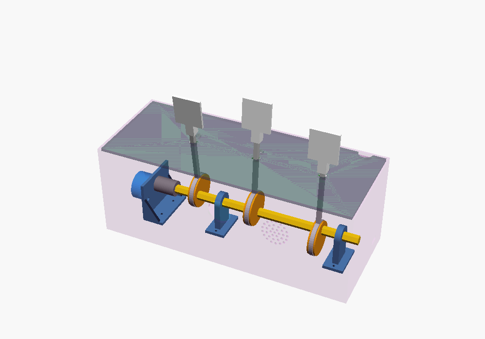
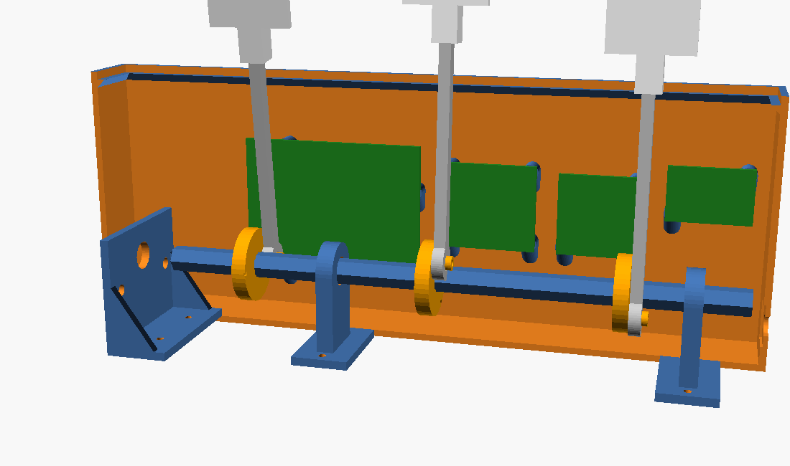

# Autómata de Halloween 🎃

Caja con tres figuras de Halloween (fantasma, momia y parca de una guirnalda LED) que bailan cuando alguien pasa por delante. Un motor paso a paso mueve un cigüeñal con tres manivelas desfasadas 120°: cada figura sube, baja y cabecea a su ritmo.

## Cómo funciona

- **Motor:** 28BYJ-48 (5 V) con driver ULN2003, a unos 10 rpm.
- **Mecanismo:** eje hexagonal de 8 mm con tres manivelas iguales; al montarlas se giran dos caras del hexágono (120°) entre sí. Cada biela pivota en un agujero de la tapa y lleva arriba una paleta donde se pega la figura.
- **Disparo:** sensor PIR HC-SR501 en la pared frontal. Al detectar a alguien, las figuras bailan 20 s con tramos aleatorios y algún cambio de sentido.
- **Control:** Arduino (Nano/Uno).
- **Sonido:** módulo grabador de voz con un efecto grabado que suena al empezar cada baile, por un altavoz de 8 Ω 2 W tras una rejilla en la pared frontal.
- **Alimentación:** 5 V por un conector USB-C de panel en el lateral.

## Estructura

| Carpeta | Contenido |
|---|---|
| `cad/` | Diseño paramétrico en OpenSCAD (`MODO` elige montaje, piezas, caja, tapa…) |
| `stl/` | Piezas exportadas listas para laminar |
| `firmware/` | Sketch de Arduino |
| `docs/` | Vistas del montaje y plantilla 2D de la tapa |

## Piezas a imprimir

| STL | Cantidad | Notas |
|---|---|---|
| `eje.stl` | 1 | 200 mm, tumbado sobre una cara plana |
| `manivela.stl` | 3 | Disco abajo, pasador hacia arriba |
| `biela.stl` | 3 | Plana |
| `paleta.stl` | 3 | Cara de pegar la figura contra la cama |
| `acople.stl` | 1 | De pie |
| `soporte.stl` | 2 | De pie, sin soportes |
| `soporte_motor.stl` | 1 | De pie, sin soportes |
| `caja.stl` | 1 | Boca arriba, 251 × 101 × 95 mm (cabe en la Kobra X) |
| `tapa.stl` | 1 | Plana |

## Material

- Motor 28BYJ-48 + placa ULN2003
- Sensor PIR HC-SR501
- Arduino Nano o Uno
- Conector USB-C de panel con cables
- Módulo grabador de voz (30/120 s), altavoz 8 Ω 2 W (30 mm) y un diodo 1N4007 o 1N4148
- Tornillería: 3 × M3x8 + arandela (retienen las bielas), 2 × M3/M4 (motor), 6 × M3x8 avellanados de rosca chapa (soportes desde debajo de la caja), 2 × M2 de rosca chapa (PIR), 12 × rosca chapa M3/2,9 x 10 (placas electrónicas)
- Opcional: transistor NPN (2N2222/BC547) + resistencia de 1 kΩ para encender la guirnalda solo mientras bailan

## Conexiones

| Componente | Pin | Arduino |
|---|---|---|
| HC-SR501 | VCC / GND / OUT | 5V / GND / D2 |
| ULN2003 | IN1–IN4 | D8–D11 |
| ULN2003 | + / − | 5 V y GND del USB-C |
| Módulo de sonido | B+ / GND | 5V **a través de un diodo** (~4,3 V) / GND |
| Módulo de sonido | Pad de reproducción por flanco | D6 |
| Módulo de sonido | SPK | Altavoz 8 Ω |
| Guirnalda (opcional) | Base del NPN vía 1 kΩ | D5 |

Ajustes del HC-SR501: jumper en **H** (redisparo) y potenciómetro de tiempo al mínimo; la duración del baile la decide el código. Al encender, el PIR necesita ~1 minuto para estabilizarse.

## Avisos

- **USB-C:** muchos conectores de dos cables no llevan las resistencias de 5,1 kΩ en CC. Sin ellas, un cargador USB-C a USB-C no da corriente; usa un cable USB-A a USB-C.
- **Hueco del USB-C:** está dimensionado con valores típicos (13 × 7 mm). Mide el conector y ajusta `usb_w`, `usb_h` y `usb_pared` en el `.scad`. Conviene imprimir primero un trozo de pared de prueba.
- **Altavoz:** de 30 mm (`alt_d`). Se coloca con el cono hacia la rejilla dentro del aro y se fija con unos puntos de termocola.
- **Placas electrónicas:** van de pie en la pared trasera sobre columnas de 6 mm (el Uno no cabe tumbado). Las medidas del Uno son las oficiales; las del ULN2003, el módulo de sonido y la placa del transistor son provisionales: mide la posición de sus agujeros y ajusta la lista `placas` antes de imprimir la caja.
- **Lente del PIR:** ajusta `pir_sep` según el grosor de la base de la lente.
- **Motor parado:** el sketch apaga las bobinas al terminar cada baile para que no se caliente.

## Grabar el sonido

Mantén el pad REC a masa (o su pulsador) y reproduce el efecto desde el móvil pegado al micrófono, en silencio. Graba unos 20 s para que coincida con `DURACION_BAILE`. El pin D6 dispara la reproducción con un pulso a GND; si con el pulso solo suena un instante, estás usando el pad de reproducción por nivel: cambia al de flanco.

## Montaje

1. Atornilla el soporte del motor y los dos soportes del eje desde debajo de la caja.
2. Fija el motor al soporte y encaja el acople en su eje.
3. Mete el eje hexagonal pasando por los soportes y ensarta las tres manivelas, girando cada una 120° (dos caras) respecto a la anterior.
4. Coloca las bielas en los pasadores y retenlas con tornillo y arandela.
5. Pasa las bielas por los agujeros de la tapa, encaja las paletas y pega las figuras por detrás.
6. Baja los cables de la guirnalda por los agujeros pequeños, dejando un bucle flojo dentro.
7. Pega el altavoz en su aro de la pared frontal.
8. Atornilla el Arduino, el ULN2003, el módulo de sonido y la placa del transistor a sus columnas de la pared trasera, con los componentes hacia dentro. La pila de la guirnalda va con cinta de doble cara en el suelo, detrás del mecanismo.

