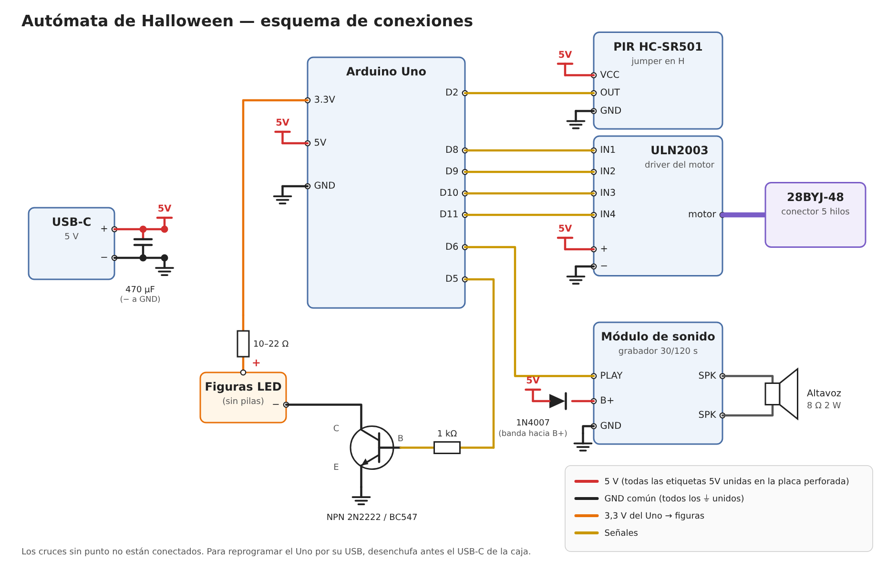

# Manual del módulo de sonido grabable (30 s / 120 s)

Manual de conexionado, configuración y grabación del módulo grabador de voz que usa el Autómata de Halloween. Está basado en la ficha del fabricante y adaptado al montaje de este proyecto.

---

## 1. Qué es

Es una placa grabadora y reproductora de sonido: graba lo que entra por su micrófono, lo guarda en memoria y lo reproduce por un altavoz cuando se activa una de sus entradas. Todas las entradas de control (grabar y reproducir) se activan **uniéndolas a GND**, como si fueran pulsadores.

| Característica | Valor |
|---|---|
| Alimentación | 3 – 5 V |
| Consumo en reposo | < 5 µA (a 3,6 V) |
| Tiempo de grabación | 30 s o 120 s, según la versión |
| Calidad | Muestreo de 16 kHz, ADPCM, convertidores de 14 bits |
| Altavoz | 8 – 32 Ω, 0,6 W con 8 Ω a 4,5 V |
| Distancia de grabación | 3 – 5 m según el fabricante (en la práctica, mucho mejor de cerca) |
| Avisos sonoros | Un pitido al empezar a grabar y dos al terminar |

> Cada grabación nueva **borra la anterior**.

---

## 2. Identificación de los pads

Los nombres van serigrafiados junto a cada pad. Algunos aparecen girados o abreviados, así que compruébalos con lupa en tu placa antes de soldar.

| Pad | Función | Se usa en el autómata |
|---|---|---|
| **B+** | Alimentación positiva | Sí: 5 V a través de un diodo |
| **GND** | Alimentación negativa (masa) | Sí: GND común |
| **SPK** (2 pads) | Altavoz | Sí: altavoz de 8 Ω (sin polaridad) |
| **MIC +** / **MIC −** | Micrófono electret | Solo para grabar |
| **GN** (o GND) | Masa de los pulsadores | Referencia para los modos |
| **RL** | Grabar **mientras está a GND**; al soltar, termina | Para grabar (opción A) |
| **RE** | Pulsar una vez empieza a grabar, pulsar otra vez termina | Para grabar (opción B) |
| **PL** | Reproduce **en bucle mientras está a GND** | No |
| **PE** | Un pulso reproduce la grabación completa una vez | **Sí: va al pin D6 del Arduino** |
| Resto (LB, FV+, P…) | Funciones internas o de fábrica | No conectar |

### Cómo confirmar los pads con un cable

Con el módulo alimentado y el altavoz puesto, toca con un cable fino entre **GN** y cada pad, uno a uno. Es inofensivo, porque son entradas pensadas para pulsadores.

- Si al tocar **PE** un instante suena la grabación completa, ese es PE.
- Si al tocar **PL** suena solo mientras mantienes el contacto, y en bucle, ese es PL.
- Si al tocar **RL** o **RE** oyes un pitido, ese pad es de grabación. Al hacer la prueba se graba encima de lo que hubiera, así que hazla antes de grabar el sonido bueno.

---

## 3. Conexionado en el autómata



| Pad del módulo | Se conecta a | Notas |
|---|---|---|
| **B+** | 5 V de la placa de reparto, **a través de un diodo 1N4007 o 1N4148** | La banda del diodo va hacia B+. Así le llegan unos 4,3 V, con margen bajo el máximo de 5 V aunque el cargador USB dé algo más |
| **GND** | GND común | La misma masa que el Arduino |
| **PE** | Pin **D6** del Arduino | Cable directo, sin resistencia |
| **SPK + SPK** | Altavoz de 8 Ω y 2 W | Cualquier polaridad |
| **MIC + / MIC −** | Micrófono electret | Solo mientras grabas. Puedes quitarlo después |

### Cómo lo dispara el Arduino

En reposo, el pin D6 queda en **alta impedancia**: no manda ni 0 V ni 5 V. Al empezar cada baile lo pone a **GND durante 100 ms** y lo vuelve a soltar, igual que si alguien pulsara un botón entre PE y GN. De esta forma el Arduino nunca mete 5 V en el módulo, que funciona a unos 4,3 V.

Esta es la parte del sketch (`firmware/automata_halloween/automata_halloween.ino`) que lo hace:

```cpp
void dispararSonido() {
  pinMode(PIN_SONIDO, OUTPUT);
  digitalWrite(PIN_SONIDO, LOW);
  delay(100);
  pinMode(PIN_SONIDO, INPUT);
}
```

---

## 4. Configuración

### Duración del sonido y del baile

El baile dura lo que diga `DURACION_BAILE` en el sketch, 20 s por defecto. Lo ideal es que la grabación dure lo mismo:

- **Si grabas unos 20 s**, no hace falta tocar nada.
- **Si grabas otra duración**, cambia `DURACION_BAILE` al mismo tiempo, en milisegundos. Por ejemplo, para un sonido de 25 s:

```cpp
const unsigned long DURACION_BAILE = 25000;
```

### Volumen

El módulo no tiene control de volumen. Si suena demasiado fuerte, pon una resistencia de 10 a 22 Ω en serie con uno de los cables del altavoz. Si suena flojo, pega bien el altavoz a su aro para que la caja haga de caja acústica.

### Modo de reproducción

Usa siempre **PE** (un disparo, reproducción completa). Con **PL**, el sonido solo duraría los 100 ms del pulso del Arduino.

---

## 5. Grabación del sonido

Graba **antes de meter el módulo en la caja**, en una mesa y en una habitación silenciosa.

### Qué necesitas

- **Micrófono electret de dos patas**, la cápsula redonda típica de unos 6–10 mm. Si tu módulo no lo trae soldado, hace falta uno.
- **Polaridad del micrófono:** la pata unida a la carcasa metálica (se ven las pistas) es la negativa y va a **MIC −**. La otra va a **MIC +**.
- **Alimentación provisional:** 5 V a través del diodo, o directamente 3 pilas AA (4,5 V), entre B+ y GND.
- **El altavoz conectado,** para escuchar el resultado.
- **El efecto de sonido** en el móvil o el ordenador.
- **Un pulsador pequeño o un cable** para hacer de botón de grabación.

### Opción A: grabar mientras se mantiene pulsado (RL)

Es la más cómoda si sabes exactamente cuánto dura el sonido.

1. Pon el móvil con el altavoz a unos **10–20 cm del micrófono**, con el volumen a la mitad.
2. Une **RL a GN** con el pulsador o el cable. Sonará **un pitido**.
3. Justo después del pitido, dale al play en el móvil.
4. Cuando termine el sonido, **suelta**. Sonarán **dos pitidos**: la grabación ha terminado.

### Opción B: pulsar para empezar y pulsar para terminar (RE)

Va mejor si tienes que manejar el móvil con las dos manos.

1. Coloca el móvil igual que en la opción A.
2. Toca **RE con GN** un instante. Sonará **un pitido** y empieza a grabar.
3. Reproduce el sonido en el móvil.
4. Al terminar, vuelve a tocar **RE con GN** un instante. Sonarán **dos pitidos** y la grabación termina.

### Comprobar la grabación

Toca **PE con GN** un instante: tiene que sonar la grabación completa. Si no te convence, repite la grabación. La nueva sustituye a la anterior.

### Consejos para que suene bien

- **Silencio total en la habitación:** el micrófono lo capta todo, incluido el motor si está en marcha.
- **Si suena distorsionado,** aleja el móvil o baja su volumen.
- **Si suena flojo o con ruido,** acerca el móvil.
- **Edita el efecto antes de grabarlo:** que empiece fuerte desde el primer segundo y que no pase de 30 s (o de 120 s en la versión larga).
- **El pitido inicial y el final** quedan fuera de la grabación, así que no se oirán en la fiesta.

### Alternativa sin micrófono: grabar por cable

Si no tienes micrófono, puedes meter el audio del móvil por cable a los pads del micrófono con este pequeño circuito:

```
Jack 3,5 mm (punta, canal izquierdo) ── 10 kΩ ──┬── 1 µF ── MIC +
                                                │
                                              1 kΩ
                                                │
Jack 3,5 mm (malla, masa) ──────────────────────┴────────── MIC −
```

Empieza con el volumen del móvil **muy bajo** y ve subiéndolo hasta que la grabación suene limpia. Si suena saturada, baja el volumen. Sigue los mismos pasos de la opción A o la B.

---

## 6. Solución de problemas

| Problema | Causa probable | Solución |
|---|---|---|
| No suena nada al dispararlo | Falta la masa común con el Arduino, o el diodo está al revés | Comprueba GND y que la banda del diodo mire hacia B+ |
| Suena solo un instante | Está conectado a PL en vez de a PE | Pasa el cable de D6 a PE |
| Con el Arduino no suena, pero tocando PE con un cable sí | El pin no es el correcto, o el sketch no llega a `dispararSonido()` | Revisa que va a D6 y mira el monitor serie: debe salir «¡A bailar!» |
| Al grabar no hay pitido | Alimentación insuficiente, o pad equivocado | Mide unos 4,3 V entre B+ y GND, y repite la prueba de pads |
| Grabación con mucho ruido o muy baja | Micrófono al revés o lejos | Da la vuelta al micrófono o acerca el móvil |
| Se corta antes de acabar | El sonido supera la capacidad del módulo | Recorta el efecto a menos de 30 s (o de 120 s) |
| El sonido sigue cuando las figuras ya han parado | La grabación dura más que el baile | Iguala `DURACION_BAILE` a la duración del sonido |
